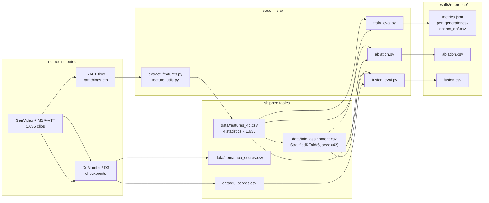

# Pipeline and module map

Two things are computed from video and shipped as tables: the four turbulence
statistics, and the per-clip scores of two third-party detectors. Everything else
in the package is a learner on top of the four statistics.

## Module responsibilities

| Module | Reads | Writes | Reproduces |
|---|---|---|---|
| `src/feature_utils.py` | frames | — | global-motion removal, Helmholtz projection, the four statistics |
| `src/extract_features.py` | a directory of videos | one CSV per directory | new rows for `features_4d.csv` |
| `src/train_eval.py` | features + folds | `metrics.json`, `per_generator.csv`, `scores_oof.csv`, `scores_loo.csv` | Tables 3 and 5, the 0.918 headline |
| `src/ablation.py` | features + folds | `ablation.csv`, `ablation.json` | Table 4 (11 feature sets) |
| `src/fusion_eval.py` | features + folds + D3 scores | `fusion.csv`, `fusion.json` | Table 9 (rows B, A, C, D) |
| `scripts/verify_release.py` | the four data tables + `results/reference/` | stdout | 26 integrity and consistency checks, no model fits |
| `scripts/reproduce_all.sh` | — | — | the four commands above, in order |

## Where the four statistics come from

1. Resize to 256 × 256, 8 fps, CRF 23.
2. Draw 20 frames uniformly at random with `RandomState(42)`, then sort them.
   Taking the first 20 frames instead gives different statistics for the same clip.
3. Dense optical flow (RAFT, or Farneback without weights).
4. Subtract global camera motion with a RANSAC homography fitted on a ~22 × 22
   grid of points.
5. Keep only the solenoidal component of the Helmholtz decomposition.
6. `F_low` — multi-scale flatness over ℓ = 1, 2, 3; `omega_max` — maximum
   vorticity magnitude; `max_temporal`, `p999_temporal` — maximum and 99.9th
   percentile of the temporal flow increment.

Only step 6 differs between the feature table and a re-extraction: the four
numbers, not the pixels, are what the learners see.

## Reading order for the documentation

`README.md` (what the package is) → `docs/TABLES.md` (what regenerates what) →
`docs/REPRODUCIBILITY.md` (protocols, counts, drift) → `docs/REVIEWER_GUIDE.md`
(the five-minute check) → `docs/PUBLISHING.md` (how the DOI is minted).
